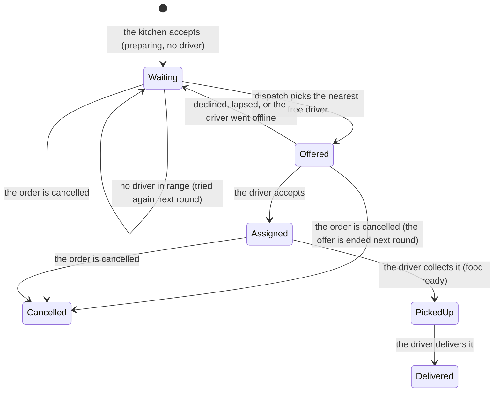

# How an order finds a driver

When the kitchen accepts an order it goes from `paid` to `preparing`. Nothing chooses a driver at that moment.
A background job, **dispatch**, notices that the order is being prepared and has no driver, and **offers** it to
the nearest free driver. The driver has a minute to say yes or no. A no, or silence, sends it to the next driver.
A yes makes it that driver's delivery.

This page says what each part is, what it promises, and what keeps the promise. The code is in
`internal/dispatch` (the job and the choice), `internal/databases/adapters/dispatch.go` (the offers),
`cmd/handlers/driver.go` and `driver_jobs.go` (what a driver may do), and `schema.sql` (the tables and the
indexes that matter most).

## The pieces

- **A driver** is an account with the role `driver` (staff make one under *People*, or `go run ./cmd/user -role
  driver`) and a row in `drivers`: whether they are *online*, the last point they sent, and when. One point, replaced
  by the next, forgotten when they go offline. Whether a driver is *busy* is not stored: it is read from the orders
  (an order assigned to them that is `preparing` or `picked_up`), so it cannot disagree with them.
- **An offer** is one order offered to one driver. It is a lease: while it is open the order is held for that driver
  and for nobody else, until `expires_at`. It ends once, as `accepted`, `declined` or `expired`.
- **The history** is the `order_offers` table: every offer that was made, to whom, when, and how it ended. A row is
  made and ended once, and a trigger refuses any other change to it.

## What happens to an order

`Waiting`, `Offered` and `Assigned` are all the order state `preparing`; what tells them apart is whether it has an
open offer and whether `assigned_driver_id` is set.

## Choosing the driver

`dispatch.Pick` is a pure function: given where the restaurant is, the radius, the time and the candidates, it says
who gets the offer.

1. A candidate is dropped if their point is not a place, is older than `MaxLocationAge` (3 minutes; a driver's app
   sends one every 30 seconds), or is farther than the radius from the restaurant (`DISPATCH_RADIUS_KM`, default 8;
   exactly the radius is in).
2. The rest are ranked by distance to the restaurant (`domain.DistanceKm`), **to the nearest 10 metres**.
3. Equally near drivers (within the same 10 metres) are told apart by who has been **idle longest**, then by id, so
   the answer never depends on the order the candidates arrived in.

The 10 metre step is deliberate: a few metres of GPS noise should not decide who gets an order. The store has already
applied the age limit with the database's clock (the clock that stamped the point), so this server's clock is never
compared with it.

A **candidate** (`ListCandidates`) is a driver who is online, not disabled, has a point newer than the limit, holds
no unfinished delivery, has no open offer, and has **not already been offered this order** (a driver who said no, or
let it lapse, is not asked again about the same order). A driver who comes online later is a candidate at once.

If nobody qualifies the order simply waits and is looked at again next round. Nothing is logged for it every round.

## The job

`dispatch.Service.RunOnce`, every `DISPATCH_INTERVAL` (default 10 s):

1. **End lapsed offers**: those whose lease has run out, and those whose order no longer needs a driver (cancelled,
   or already has one).
2. **List waiting orders**, oldest first, up to a batch of 20: preparing, no driver, no open offer, restaurant placed.
3. For each: list candidates, `Pick`, and `OfferOrder`. If the offer is not made because something changed since the
   lists were read, that is counted as skipped and the order is looked at again next round.

A problem with one order is logged and counted and never stops the others. A round that is told to stop (shutdown)
leaves the rest for the next one.

## The promises, and what keeps them

| Promise | What keeps it |
|---|---|
| An order is never offered to two drivers at the same time | unique index `order_offers_one_open_per_order` (one `offered` row per order) |
| A driver is never offered two orders at the same time | unique index `order_offers_one_open_per_driver` |
| A driver never holds two deliveries | unique index `orders_one_active_job_per_driver` (one `preparing`/`picked_up` order per driver) |
| Several servers can run the job at once | there is no lock in the application: every decision is one SQL statement or a transaction, and the indexes decide a race, so of two inserts at the same moment exactly one succeeds |
| A lease that ran out is never completed by the driver who held it | `AcceptOffer` and `DeclineOffer` judge the lease with `clock_timestamp()` at the moment they run, not at the start of a transaction, so a lease that ran out while an accept waited its turn is gone |
| An accept either sets the driver and ends the offer, or does neither | one transaction: the offer is marked accepted and the order's driver is set; if the order moved on (cancelled) or the driver is busy the whole thing rolls back |
| A driver who has just accepted is not handed another offer to hold | `OfferOrder` and `AcceptOffer` take the driver's row lock first, so for one driver they happen one after the other, and the "holds no delivery" check is a statement that starts after the lock is granted |
| Two taps on Accept make one delivery | the second finds the offer already accepted and is told it is gone |
| A driver who goes offline does not hold an offer | going offline ends their open offer in the same transaction |
| The history is never rewritten | trigger `order_offers_only_end`: an offer may only be ended, once; nothing else about it may change |

All times in an offer are the database's own clock. The browser, this server and the database need not agree (the
Docker VM's clock is a couple of seconds from the host's, which a test found), so the driver's countdown is not
counted down to a time of day: the offer says **how many seconds are left** (`remainingSeconds`, read from the
database at that moment) and the browser counts that down on its own clock.

One race was found by a test, not by thinking: an offer to a driver read "holds no delivery" just before that
driver's accept committed, and a driver who had just taken a delivery was handed another order to hold for the whole
lease. The driver-row lock above is the fix. It is tested deterministically (the lock is held while the offer is
made) and by a system test that runs three dispatch servers, 14 orders and five drivers at once and checks that no
order and no driver was ever offered twice at the same time.

## What a driver may do and see

The routes are `driverOnly`; a driver can reach **nothing** else of the customer's or staff's (the guards were
changed so that "signed in" means a customer or a staff member), apart from signing out, who-am-I and changing their
password.

| Route | What it does |
|---|---|
| `POST /driver/online`, `/driver/offline` | taking deliveries or not |
| `POST /driver/location` | replaces their point (6 a minute at most, only while online, only a real place) |
| `GET /driver/me` | their own state |
| `GET /driver/offers` | the one open offer: restaurant name and place, how far it is, seconds left |
| `POST /driver/offers/{id}/accept`, `/decline` | answer it; an offer that cannot be answered is always the same 404, whatever the reason |
| `GET /driver/job` | their delivery: restaurant, how many items, where it goes |
| `POST /orders/{id}/pickup`, `/deliver` | only their own delivery; any other order is "not found" |

A driver is never shown who ordered, what, what it cost, or how it was paid. They see the **delivery address and
landmark only for the delivery they have accepted**, never in an offer, and not the customer's own name for the
place ("Home"). When a driver acts on an order the answer is the job, not the order.

Customers and staff see the driver on an order: staff the whole name (and the id they act on), a customer only the
**first name** and never the driver's account id.

## Settings

| Variable | Default | |
|---|---|---|
| `DISPATCH_INTERVAL` | `10s` | how often the job looks for orders that need a driver |
| `DISPATCH_RADIUS_KM` | `8` | how far from a restaurant a driver may be and still be offered its orders (above 0, up to 100) |

The lease (60 seconds), how old a point may be (3 minutes) and the batch (20) are the defaults of
`dispatch.NewService`.

## What it does not do yet

See `KNOWN_ISSUES.md`. In short: an order every driver in range has refused or let lapse waits for a new driver (it is
not offered again to the same drivers); a driver is not told by a push, only by the screen polling every 3 seconds; a
restaurant has no street address, so a driver is given its name, its place on the map and a link, not a street;
distance is a straight line; and there is no pay, rating or shift.
