# Design patterns in SwiftDrop

One place to look up every pattern we have used or will use: what it is, the problem it solves *here*, where it lives in the code, its trade-offs, and which neighbour it is easily confused with. Each pattern has a diagram next to its text.

How to use it:

- **Status** is `Covered` (built and tested), `Partly` (the idea is in the code, not the full pattern) or `Planned` (not built yet).
- File and symbol names are real as of the commit that last touched this file. If a name here no longer exists, the code won.
- The planned patterns come from the pattern map in the project spec (`context.md`, section 2). The spec's planned package names are guidance; the code lives where it makes sense (for example payments are in `internal/payment`, not `internal/provider`).
- The rule from the spec still applies: a pattern has to solve a real problem here. If it would only exist to be a pattern, we don't build it.
- **Diagrams are [Mermaid](https://mermaid.js.org/).** GitHub draws them in the page. In VS Code, install a Markdown Mermaid preview extension; without one you see the source, which is still readable. Diagrams of things that do not exist yet are marked *planned* or *illustrative*.

---

## 1. Status at a glance

| # | Pattern | Status | Where it is today | Planned use |
|---|---|---|---|---|
| 1 | Repository | Covered | `ports.IDatabase` (the contract), `adapters.DBAdapter` (Postgres) | payment store, driver store, event storage |
| 2 | Adapter | Covered | `DBAdapter` (pgx to `IDatabase`), `StripeGateway` (Stripe to `Gateway`) | Maps, Twilio, other real providers |
| 3 | Strategy | Covered | `payment.PaymentProvider`: card, wallet, cash | driver matching, pricing, route selection |
| 4 | Factory | Covered | `payment.Router.For(paymentType)` | notification and routing providers |
| 5 | Chain of Responsibility | Covered | middleware chain (`CORS`, `MaxBody`, `RequireJSON`), validator chain (`validation.Chain`) | auth, rate limiting, logging, metrics |
| 6 | State | Partly | `order.legalTransitions` as a table (state as data) | driver lifecycle, state-specific behaviour if it grows |
| 7 | Decorator | Planned | middleware has the shape, not the intent | cached payment store (next), then retry, timeout, circuit breaker |
| 8 | Observer / Pub-Sub | Planned | none | event bus, an SSE stream of order events |
| 9 | Command | Planned | each endpoint is a handler method | place, cancel, assign, pickup, complete as values |
| 10 | Builder | Planned | none | orders, delivery requests, event payloads |
| 11 | Facade | Planned | `PayOrder` already orchestrates, inside a handler | `internal/service` |
| 12 | Abstract Factory | Planned | none | a region-specific bundle of providers |

Not patterns by the book, but part of how the code is built, and covered in section 14: dependency injection, ports and adapters, sentinel errors, the decline-versus-error contract, test doubles, table-driven tests, mutation checks. Planned: atomic claim and lease, idempotency key, compare-and-set, cache-aside, bounded worker pool.

### The map: where each pattern sits in the code today

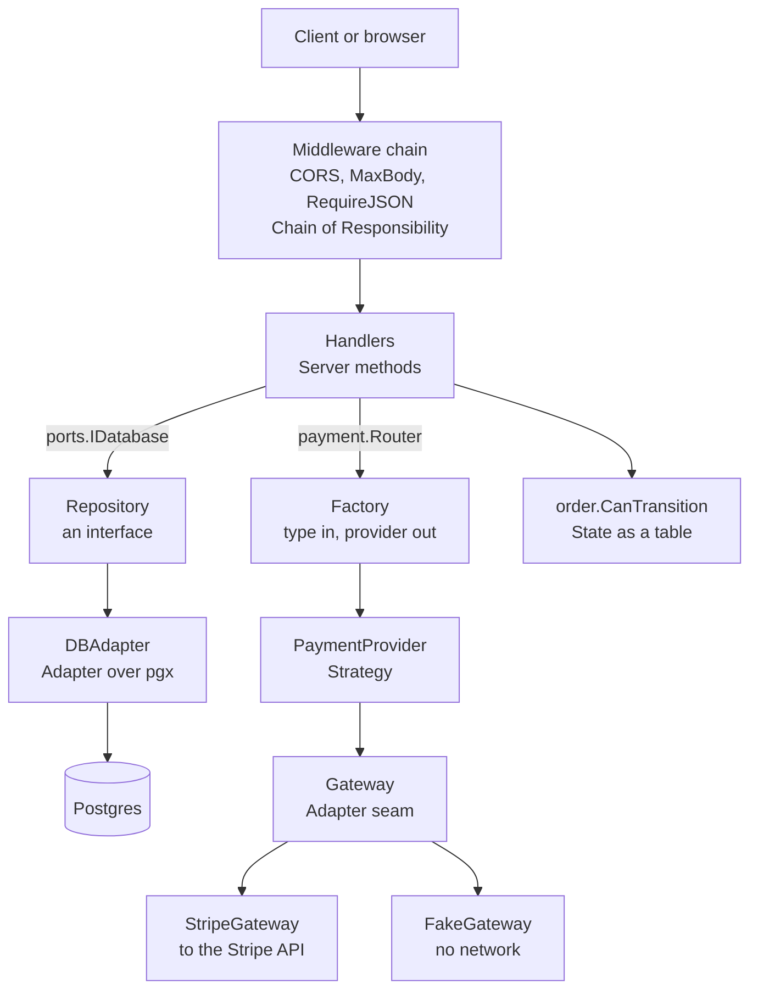

---

## 2. Repository  (Covered)

**Intent.** Put storage behind an interface that speaks the domain's language, so callers ask for orders and never write SQL or see a database driver.

**Problem here.** Handlers must not know pgx exists, and tests must run without a database.

**Shape in Go.**

```go
// internal/databases/ports/database.go
type IDatabase interface {
    CreateOrder(ctx context.Context, order domain.Order) (domain.Order, error)
    GetOrderbyId(ctx context.Context, id string) (domain.Order, error)
    UpdateOrderState(ctx context.Context, id string, state string) (domain.Order, error)
    SetFoodReady(ctx context.Context, id string) (domain.Order, error)
    AcceptOrder(ctx context.Context, id string, driverID string, state string) (domain.Order, error)
}
```

**Diagram.** The handler depends on the interface; production and tests plug in different implementations.

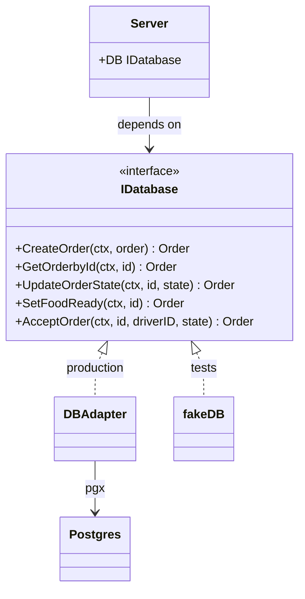

**In SwiftDrop.** The interface lives in `internal/databases/ports`; the Postgres implementation is `adapters.DBAdapter`. Handlers hold `ports.IDatabase`. Tests use an in-memory `fakeDB` that implements the same interface.

**Trade-offs.**
- The interface is defined by what the handlers need, so it grows with them. Keep it narrow.
- `IDatabase` is really the *order* repository today; the spec names `OrderRepository`, `DriverRepository` and so on. Split it when a second entity arrives, not before.
- A repository hides the query, not its cost. A method that looks cheap can hit the database every call.

**Don't confuse with.** Adapter. A repository is a *role* (domain-shaped storage access); `DBAdapter` is also an adapter because it translates pgx to that role. One type can play both.

---

## 3. Adapter  (Covered)

**Intent.** Make something with a foreign interface fit the interface the rest of your code expects.

**Problem here.** Stripe has its own request format, its own error shapes and its own vocabulary. The rest of SwiftDrop must see only our types.

**Shape in Go.**

```go
// internal/payment/gateway.go: OUR shape
type Gateway interface {
    Charge(ctx context.Context, req domain.PaymentRequest) (*domain.PaymentResult, error)
}
```

**Diagram.** The adapter translates on the way out and again on the way back, and the second translation is where the meaning matters.

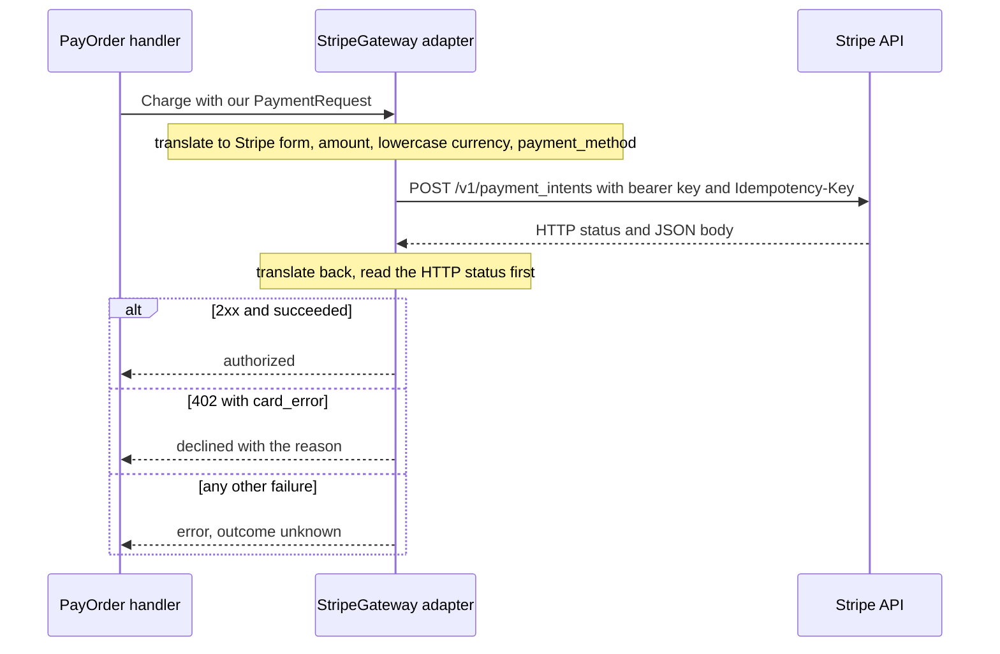

**In SwiftDrop.**
- `gateways.StripeGateway` implements `Gateway`. It turns a `domain.PaymentRequest` into Stripe's form-encoded PaymentIntent request, calls Stripe over HTTP, and turns the answer back into a `domain.PaymentResult`.
- `adapters.DBAdapter` adapts pgx to `ports.IDatabase`. Its `translate()` also converts driver errors into our sentinel errors.
- `FakeGateway` and `MockGateway` are Gateway implementations that adapt nothing; they stand in for one.

**The part that is easy to get wrong.** An adapter translates *meaning*, not only shape. Stripe answers with an HTTP status and a body; "this card was refused" and "your API key is wrong" must not both become `declined`. See section 14.4.

**Trade-offs.**
- One more layer to read and test. Worth it when the foreign API is large, unstable or changes under you.
- Keep the adapter dumb about business rules. It translates; the handler decides.

**Don't confuse with.** Decorator (same interface in and out, adds behaviour) and Facade (simplifies many things into one entry point). An adapter changes the *interface*.

---

## 4. Strategy  (Covered)

**Intent.** Define a family of interchangeable ways to do one job, so the caller can pick or swap one without changing its own code.

**Problem here.** Paying by card, wallet or cash is one job with three behaviours. The handler should not contain a growing `switch`.

**Shape in Go.**

```go
// internal/payment/provider.go: the strategy interface
type PaymentProvider interface {
    Authorize(ctx context.Context, req domain.PaymentRequest) (*domain.PaymentResult, error)
}
```

**Diagram.** One interface, three strategies; card and wallet delegate to a `Gateway` (the Adapter seam), cash needs none.

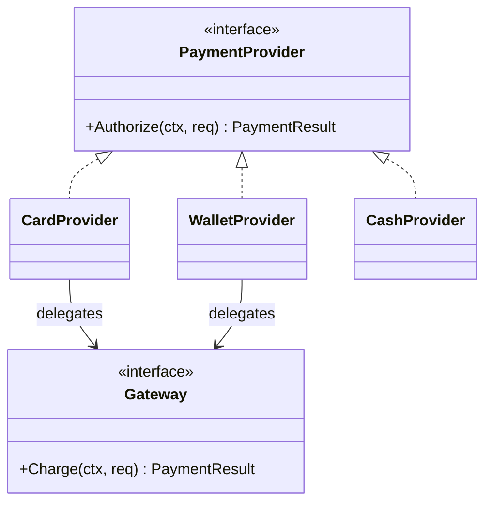

**In SwiftDrop.** `providers.CardProvider`, `providers.WalletProvider` (both delegate to a `Gateway`) and `providers.CashProvider` (authorises immediately) implement it.

**Two ways the textbook picture differs from a server.**
- The textbook *Context* holds a strategy and has `SetStrategy(s)`. A shared, mutable context is a race on a server. In SwiftDrop the handler holds a *factory* and gets the strategy as a local variable per request.
- The textbook method returns an error. Ours returns a result *and* an error, because a decline and an error are different things (14.4).

The race, drawn (illustrative, this is what we avoid):

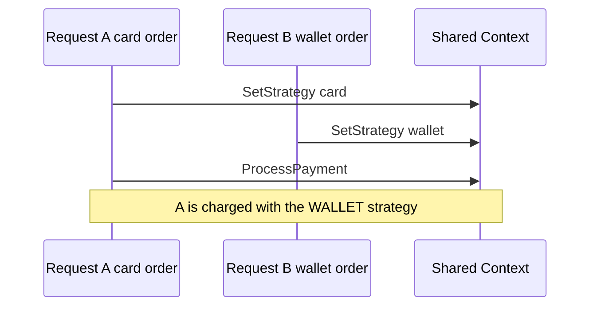

And what we do instead, with no shared state:

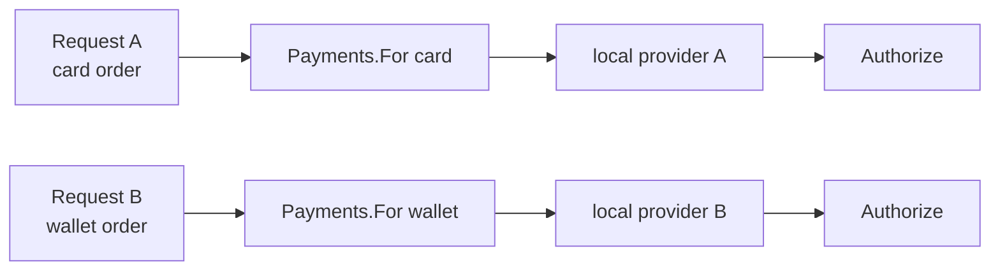

**Trade-offs.**
- Strategies shared across requests (they are built once in `main.go`) must be safe for concurrent use. Today they are stateless. A strategy with a mutable field needs a mutex.
- `CardProvider` and `WalletProvider` are currently identical pass-throughs. Fine for showing Strategy over Adapter; there is no behaviour difference yet.

**Don't confuse with.** State (the *object itself* changes behaviour as it moves between states; with Strategy the *caller* chooses) and Decorator (wraps another implementation of the same interface). Many implementations of one interface is just polymorphism; the *intent* names the pattern.

---

## 5. Factory  (Covered)

**Intent.** Move the decision "which concrete thing do I need?" out of the caller and into one place.

**Problem here.** The right provider depends on `order.PaymentType`, which is only known after the order is loaded from the database.

**Shape in Go.**

```go
// internal/payment/router.go
func NewRouter(card, cash, wallet PaymentProvider) *Router
func (r *Router) For(t domain.PaymentType) (PaymentProvider, error)
```

**Diagram.** Two moments in time: wiring (once, at startup) and request (per order). The choice must happen in the second one.

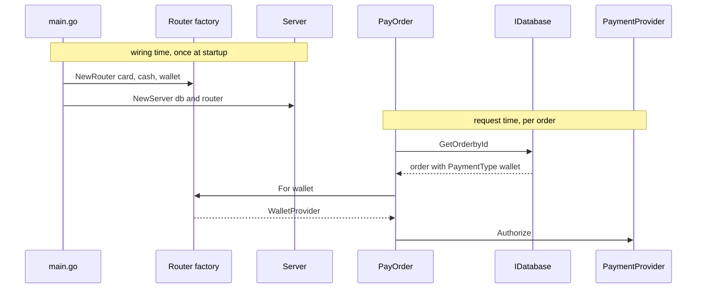

**In SwiftDrop.** `payment.Router` is a registry-based simple factory: payment type in, provider out, and an error for a type nobody registered. `Server` receives it through `NewServer(db, pay)`; `PayOrder` calls `s.Payment.For(o.PaymentType)`.

**Key insight: what gets passed to the handler.** Not a provider. A provider chosen at wiring time is one fixed provider, right for one payment type and wrong for the others (we demonstrated it: a wallet order approved by the card provider). What is passed in is the *chooser*; the choice happens at request time, when the type is known.

**Trade-offs.**
- The factory returns pre-built shared instances, not new ones per call (see Strategy's concurrency note).
- The lookup can fail (a legacy order with an empty type, a new type nobody registered), so it runs *before* any state is written. That is why an unpayable order stays `created` instead of being stranded in `payment_pending`.
- In Go a factory is usually a function or a small registry. Subclass-based "factory method" does not exist here.

**Don't confuse with.** The interface it returns. The interface is the *product*; the factory is the thing that hands one out. Also not dependency injection, though the two cooperate (14.1).

---

## 6. Chain of Responsibility  (Covered, twice)

**Intent.** Pass a request along a line of handlers; each may handle it, stop it, or pass it on.

**Problem here.** Several checks apply before a handler runs (origin, body size, content type) and several rules apply to a new order (id, items, prices). Each is small and independent.

**Chain 1: HTTP middleware.**

```go
// cmd/handlers/middleware.go
func MaxBody(maxBytes int64) func(http.Handler) http.Handler
func RequireJSON(next http.Handler) http.Handler
func CORS(allowedOrigins []string) func(http.Handler) http.Handler
```

`CORS` wraps the whole router (`Server.Handler()`), so it is the outermost link; `MaxBody` and `RequireJSON` are registered with `Router.Use`. Order matters: a link that answers stops the later ones from ever running (there is a test for exactly that).

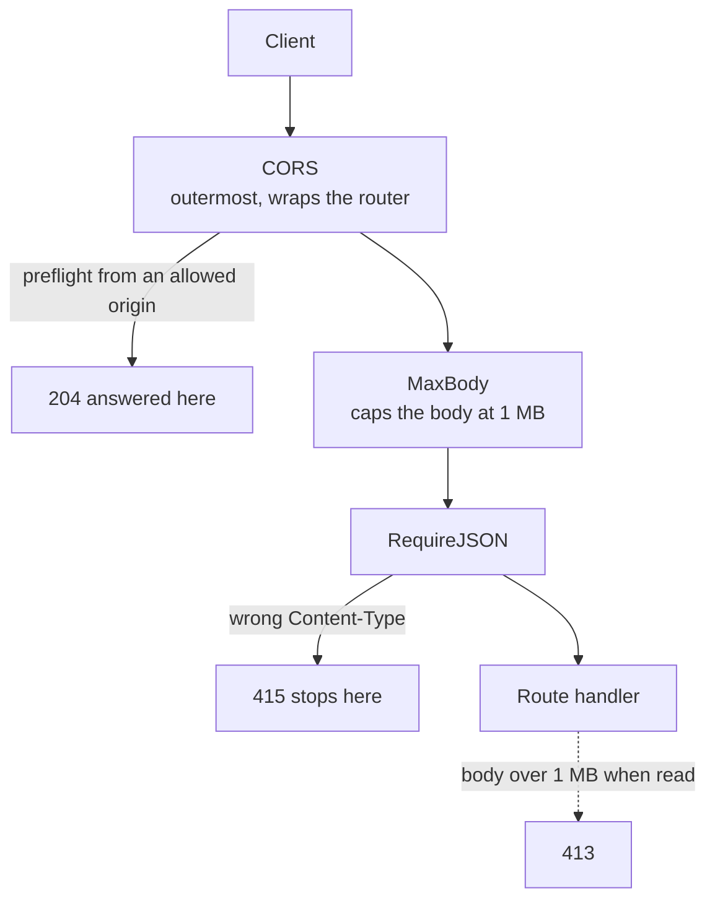

**Chain 2: validators.**

```go
// internal/validation/validation.go
type Rule func(domain.Order) error
func Chain(rules ...Rule) Rule            // first failure wins
var Order = Chain(RequireID, RequireCustomerID, RequireRestaurantID,
                  RequirePaymentType, RequireItems,
                  RequirePositiveQuantities, RequireNonNegativePrices)
```

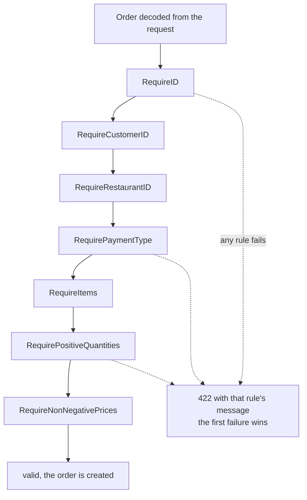

**Lessons learned.**
- CORS must be outermost so even 413, 415 and 422 error responses carry the CORS headers; otherwise a browser shows an opaque CORS failure instead of the real message.
- gorilla/mux runs `Router.Use` middleware only for *matched* routes. An OPTIONS preflight to a POST-only route is a 405 before any middleware runs, so CORS has to wrap the router, not sit inside it.
- CORS is enforced by browsers. It protects a user's logged-in session from other sites; it does not stop curl or another server.

**The browser rule, drawn** (why the page's JavaScript is stopped, not the request):

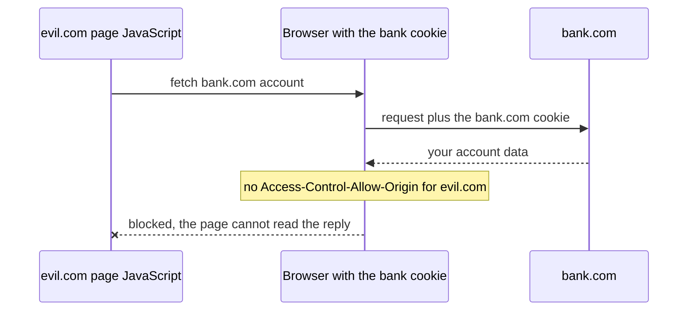

**Trade-offs.** First-failure-wins gives one error at a time (the client may need several round trips). Collecting all errors is a different design. Chains are easy to reorder by accident, so test the order.

**Don't confuse with.** Decorator. Middleware has a decorator's *shape* (`func(http.Handler) http.Handler` wraps and returns a handler); here the *intent* is a chain of gatekeepers, each allowed to stop the request. The same shape used to add behaviour around a call (retry, metrics) is Decorator.

---

## 7. State  (Partly: state as data)

**Intent.** Let an object behave according to its current state, with the legal moves between states made explicit.

**Problem here.** An order may only move along certain paths, and `cancelled` and `delivered` are terminal.

**Shape in Go.**

```go
// internal/order/state.go
var legalTransitions = map[domain.OrderState][]domain.OrderState{ ... }
func CanTransition(from, to domain.OrderState) bool
func Apply(current, to domain.OrderState) (domain.OrderState, error)   // ErrIllegalTransition
```

**Diagram.** This is exactly the `legalTransitions` table.

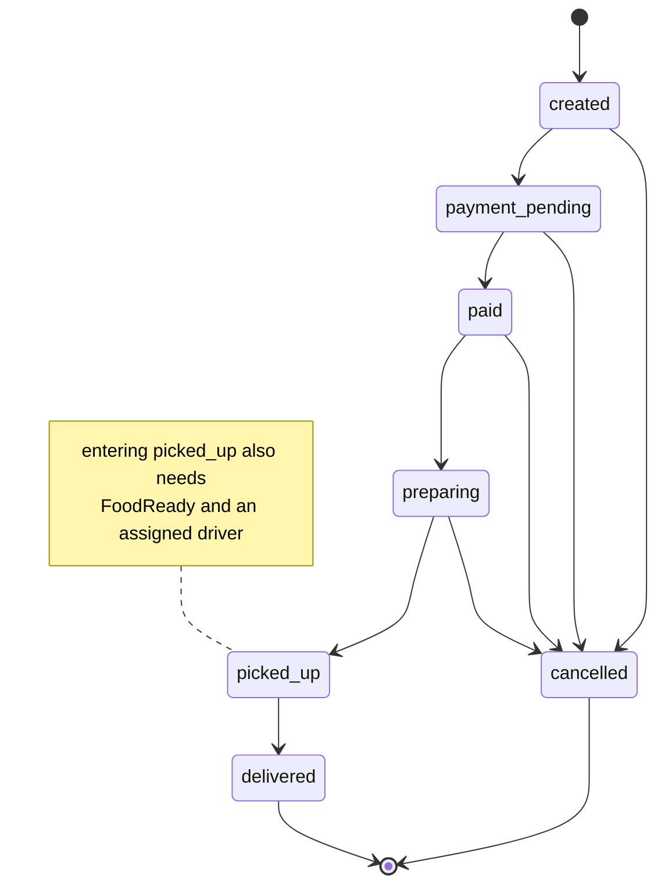

**In SwiftDrop.** The state machine is *data*: one table and two small functions. Handlers ask `CanTransition` and answer 409 when the move is not allowed. Two things that are not states are kept as independent facts: `FoodReady` and `AssignedDriverID`. Pickup is allowed only when the state allows it *and* both facts are true.

**Why a table and not the textbook (one object per state).** The behaviour that varies by state (what each endpoint does) lives in the handlers, not in state objects, so state objects would only hold the table anyway. A table is smaller and easy to test exhaustively.

**Trade-offs.**
- If behaviour per state grows (different handling of the same action by state), state objects start to pay for themselves.
- A transition table says what is *legal*; it does not make a write *atomic*. Two requests can both pass `CanTransition` and both write. Closing that needs compare-and-set (section 14.8).

**Don't confuse with.** Strategy. Strategy: the caller picks the behaviour from outside. State: the object's own current condition decides, and it moves itself along.

---

## 8. Decorator  (Planned)

**Intent.** Wrap an object that has some interface in another object with the *same* interface, to add behaviour before or after the call without changing the original.

**Problems it will solve here.**
- **Cached payment store (next feature candidate):** `CachedPaymentStore` wraps `PaymentStore`. The cache answers "what happened to payment X?" quickly; the database stays the source of truth, and the lease lives in the row, never in the cache. Because it is a decorator, we can benchmark with and without it.
- **Provider resilience:** retry with backoff, timeout, logging, metrics and a circuit breaker around `Gateway` or `PaymentProvider`.

**Shape.**

```go
type retrying struct{ next payment.Gateway; attempts int }
func (r retrying) Charge(ctx context.Context, req domain.PaymentRequest) (*domain.PaymentResult, error) { ... }
```

**Diagram (planned).** Every wrapper *is* a `Gateway` and *has* a `Gateway`, so they stack.

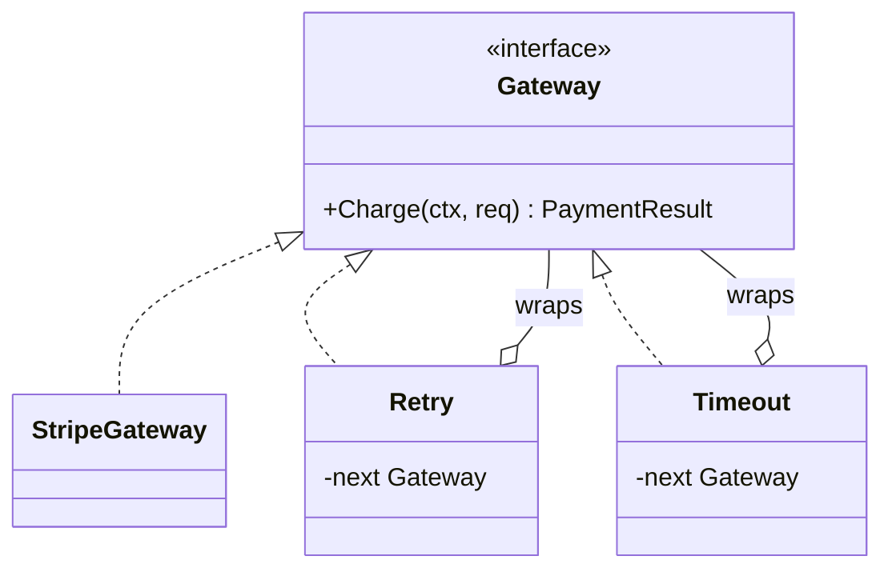

The order you wrap in decides the behaviour (illustrative):

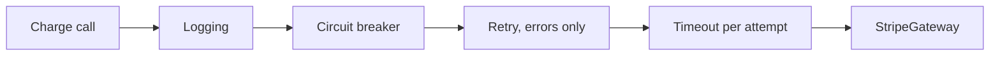

The cached store (planned) uses the same idea on the payment store:

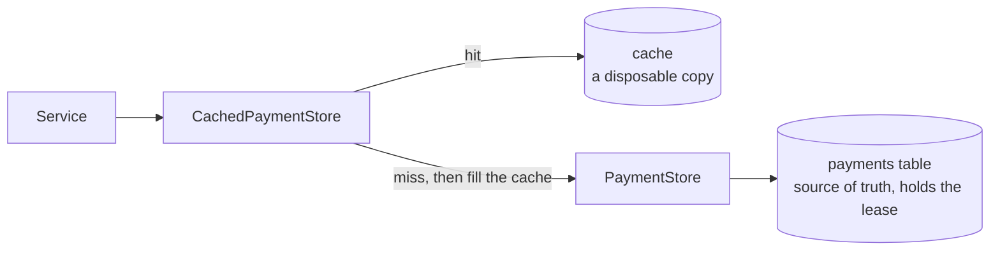

**Things to think about.**
- **Order of wrapping matters.** Retry outside a timeout means each attempt gets the timeout; timeout outside retry means the whole retry loop shares one.
- **Never retry a call that is not safe to repeat.** Retrying a charge is only safe with a stable idempotency key (14.7). A decorator that retries a decline would be a bug; only *errors* are retryable.
- A circuit breaker has state and so must be safe for concurrent use.

**Don't confuse with.** Adapter (changes the interface; a decorator keeps it) and Chain of Responsibility (links may stop the request; a decorator always calls through, even if it adds behaviour on either side).

---

## 9. Observer / Pub-Sub  (Planned)

**Intent.** Let objects react to events without the publisher knowing who they are.

**Problem it will solve here.** When an order is paid, picked up or delivered, customers, restaurants, drivers and analytics all want to know. The code that changes the state should not call each of them.

**Planned shape.** An event bus with `Publish` and `Subscribe`; a server-sent-events endpoint that streams one order's events.

**Diagram (planned).**

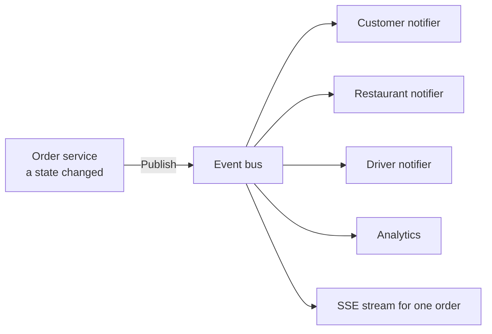

**Things to think about (this is where concurrency really starts).**
- A slow subscriber must not block the publisher: bounded buffers, and a decision about what to drop.
- Ordering: events for one order should arrive in order (the spec has an `ordered.go` for this); events across orders need not.
- Cancelling a subscriber must stop its goroutine (spec invariant: every goroutine exits when its context is cancelled).
- Delivery is at-most-once if the process dies mid-publish. Decide whether that is acceptable.

**Don't confuse with.** A callback list inside one object. Pub-Sub decouples publisher and subscriber by topic and usually by time.

---

## 10. Command  (Planned)

**Intent.** Turn an action into an object, so it can be queued, logged, retried, or undone.

**Problem it will solve here.** Place, cancel, assign, pickup and complete are actions the worker pool and the event log will want to hold as values, not as HTTP handler calls.

**Where we are.** Each action is a handler method that loads the order, checks the state, writes, and responds. A command would carry the same intent without the HTTP details.

**Diagram (planned).**

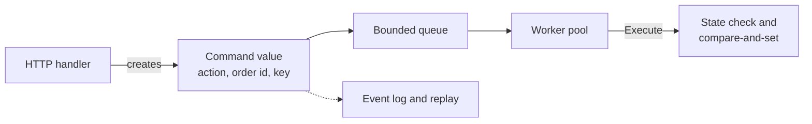

**Things to think about.**
- A command needs enough data to run later (which order, who asked, an idempotency key).
- Queued commands can run twice or out of order; the state machine and compare-and-set are what keep that safe.

**Don't confuse with.** A plain function call. Use Command when you need to *do something with the action* (queue, log, replay), not merely perform it.

---

## 11. Builder  (Planned)

**Intent.** Construct a complex object step by step, validating as you go.

**Problem it will solve here.** Orders, delivery requests and event payloads have many fields, some optional and some derived.

**Diagram (illustrative).**

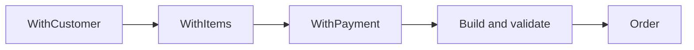

**Go note.** Go usually reaches for a struct literal, a constructor function, or functional options before a Builder. Add one only when construction has real steps or many optional parts. Today `CreateOrder` builds from a decoded request plus server-owned fields (`State`), which does not need it.

---

## 12. Facade  (Planned)

**Intent.** One simple entry point in front of several subsystems.

**Where we are, and why it matters.** `PayOrder` is about 70 lines: it loads the order, checks the state, looks up a provider, writes `payment_pending`, calls the provider, then writes `paid` or `cancelled`, and maps every outcome to an HTTP status. That is orchestration inside an HTTP handler.

**Planned.** `internal/service`: an order service that coordinates order, payment, restaurant, dispatch and events. The handler would only translate HTTP to a service call and the result back. The payment claim and idempotency work (section 14.7) is the natural moment to extract it, because the orchestration gets longer.

**Diagram.** Today versus planned.

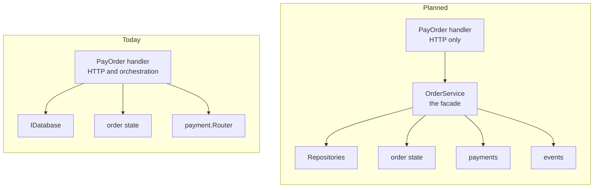

**Don't confuse with.** Adapter (makes *one* foreign thing fit; a facade simplifies *many*).

---

## 13. Abstract Factory  (Planned)

**Intent.** Build a whole *family* of related objects that must be used together.

**Problem it will solve here.** A region needs a consistent bundle: its payment provider, its routing provider and its notification provider. Mixing a regional payment provider with another region's notifications would be a bug.

**Versus what we have.** `payment.Router` is a factory for *one* product (a payment provider by type). An abstract factory returns the *set*, so the choice is made once per region.

**Diagram (illustrative, the provider names are made up).**

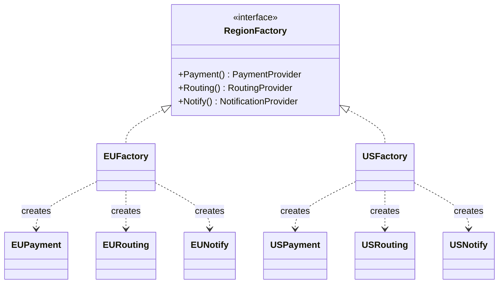

---

## 14. Techniques and idioms we rely on

### 14.1 Dependency injection
A component receives what it needs instead of creating it. `NewServer(db, pay)` receives a database and a payment router; `main.go` decides which implementations. This is what lets tests pass a fake database and a stub gateway through the same handler that ships. It is a technique, not a GoF pattern, and it cooperates with Factory: inject the *chooser*, let the handler choose per request.

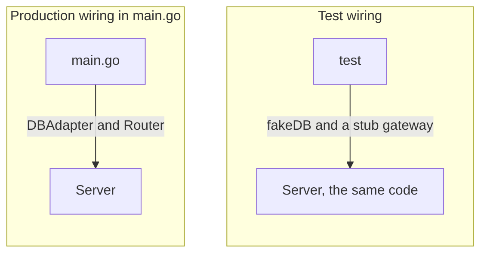

### 14.2 Ports and adapters (hexagonal)
The domain and handlers depend on interfaces (ports) they define; infrastructure (Postgres, Stripe) plugs in from outside as adapters. Dependencies point inward. `ports.IDatabase` and `payment.Gateway` are ports.

```mermaid
flowchart LR
    subgraph Outside["Infrastructure: adapters"]
        PGX["DBAdapter, pgx, Postgres"]
        STR["StripeGateway, HTTP, Stripe"]
        FK["FakeGateway"]
    end
    subgraph Inside["Our code: handlers and domain"]
        H["Handlers"]
        P1(["port: IDatabase"])
        P2(["port: Gateway"])
    end
    H --> P1
    H --> P2
    PGX -.->|"implements"| P1
    STR -.->|"implements"| P2
    FK -.->|"implements"| P2
```

### 14.3 Sentinel errors and translation at the boundary
Storage errors cross the `IDatabase` boundary as sentinels (`ports.ErrOrderNotFound`, `ports.ErrOrderExists`); handlers use `errors.Is` and never see pgx. The adapter's `translate()` does the conversion. Keep driver-specific types on their side of the wall.

```mermaid
flowchart LR
    PG["pgx: ErrNoRows or SQLSTATE 23505"] --> TR["translate in DBAdapter"]
    TR --> E1["ErrOrderNotFound"]
    TR --> E2["ErrOrderExists"]
    E1 --> H1["handler: errors.Is, then 404"]
    E2 --> H2["handler: errors.Is, then 409"]
```

### 14.4 Decline versus error
A payment call has three outcomes, not two:
- **Approved:** definite yes.
- **Declined:** definite no (the card was refused, no money moved). A normal result, `err == nil`, and the order goes to `cancelled`.
- **Error:** we do not know what happened (bad key, rate limit, outage, a payment still processing). `err != nil`, the order stays `payment_pending`, the cause goes to the log and never to the client.

Treating an error as a decline cancels a customer's order for no reason; treating a decline as an error leaves orders stuck.

How `StripeGateway` classifies a reply (HTTP status first):

```mermaid
flowchart TD
    R["Reply from Stripe"] --> Q{"HTTP status"}
    Q -->|"2xx"| I{"PaymentIntent status"}
    Q -->|"402 with card_error"| D["DECLINED<br/>definite no<br/>order to cancelled, answer 402"]
    Q -->|"400 401 403 404 409 424 429 5xx"| E["ERROR<br/>outcome unknown<br/>order stays payment_pending, answer 500"]
    I -->|"succeeded"| A["APPROVED<br/>order to paid"]
    I -->|"requires_payment_method with a recorded error"| D
    I -->|"processing, requires_action and others"| E
```

And what the handler does with each outcome:

```mermaid
stateDiagram-v2
    created --> payment_pending : lookup the provider first, then save
    payment_pending --> paid : approved
    payment_pending --> cancelled : declined, answer 402
    payment_pending --> payment_pending : error, answer 500, outcome unknown
```

### 14.5 Test doubles, named properly
- **Fake:** a working lightweight implementation (`fakeDB` is an in-memory repository; `FakeGateway` decides by amount).
- **Stub:** returns what the test told it to (`MockGateway{Result, Err}`).
- **Spy:** records the calls it received (`recordingGateway`).
- A real **mock** also checks expectations itself. We mostly use fakes, stubs and spies.

### 14.6 Table-driven tests and mutation checks
Cases go in a table and run as subtests. Coverage says a line ran, not that a bug would be caught, so for risky code we also change it on purpose (flip a comparison, remove a guard) and confirm a test fails. A mutation that survives means a missing test.

```mermaid
flowchart LR
    A["Tests pass<br/>baseline"] --> B["Change the code on purpose<br/>a mutation"]
    B --> C{"Does a test fail?"}
    C -->|"yes"| D["caught"]
    C -->|"no"| E["SURVIVED<br/>a test is missing, add one"]
    D --> F["Restore the code"]
    E --> F
```

### 14.7 Atomic claim, lease and idempotency key  (Planned next)
Retrying `/pay` must never charge twice.
- **Claim:** the first request inserts a payment row (with a uniqueness rule on the order); the database picks exactly one winner. A read-then-write is not enough, because two requests can both read "nothing yet".
- **Lease:** the claim carries a deadline. It is not a promise to the client; it is the claimant telling other requests "I am working on this; stay away until then, and after that you may take over". On expiry the row stays and the next request *reconciles* with the provider using the **same payment id**. It never makes a new id.
- **Idempotency key:** the payment id is sent to the provider as its `Idempotency-Key`, so the provider itself de-duplicates. Stripe replays the saved response for a key, including 500s, but may prune keys after 24 hours.
- **Not a cache:** a cache is a disposable copy and its loss costs only speed. A lease is a coordination record and its loss costs correctness, so it lives in the database row.

The decision at the one `/pay` endpoint (planned design):

```mermaid
flowchart TD
    REQ["POST /orders/o1/pay"] --> Q{"Payment row for o1?"}
    Q -->|"no, this is NEW"| NEW["insert the row atomically<br/>new payment id, status processing, lease set"]
    NEW --> CALL["call the provider<br/>payment id is the idempotency key"]
    CALL --> REC["record authorized or declined<br/>and move the order"]
    Q -->|"yes, this is a RETRY"| S{"status"}
    S -->|"authorized"| RA["replay the success"]
    S -->|"declined"| RD["replay the decline"]
    S -->|"processing"| L{"lease expired?"}
    L -->|"no"| IP["answer 409 in progress"]
    L -->|"yes"| TO["take over atomically<br/>then ask the provider with the SAME id"]
    TO --> REC
```

The payment row's life:

```mermaid
stateDiagram-v2
    [*] --> processing : claim, new payment id
    processing --> authorized : provider says yes
    processing --> declined : provider says no
    processing --> processing : lease expired, takeover and reconcile
    authorized --> [*]
    declined --> [*]
```

Two requests, one winner (the claim):

```mermaid
sequenceDiagram
    participant A as Request A
    participant B as Request B
    participant DB as Database
    A->>DB: INSERT payment for o1
    B->>DB: INSERT payment for o1
    DB-->>A: 1 row inserted, you own it
    DB-->>B: conflict, 0 rows
    A->>A: call the provider
    B->>DB: read the existing row
    DB-->>B: processing, lease valid
    Note over B: answers in progress and never calls the provider
```

The owner crashes, a later retry reconciles:

```mermaid
sequenceDiagram
    participant A as Request A original owner
    participant DB as payments row
    participant B as Request B a later retry
    participant P as Provider
    A->>DB: claim pay-7f3, lease until t=30s
    A->>P: charge with key pay-7f3
    Note over A: the process crashes before recording
    B->>DB: retry at t=10s
    DB-->>B: processing, lease still valid, answer in progress
    B->>DB: retry at t=45s
    DB-->>B: lease expired
    B->>DB: take over with compare-and-set
    B->>P: ask with the SAME key pay-7f3
    P-->>B: the saved answer, or runs it once now
    B->>DB: record the result only if still processing
```

### 14.8 Compare-and-set (optimistic concurrency)  (Planned next)
`UPDATE ... SET state=$to WHERE id=$1 AND state=$from`: the write succeeds only if the state is still what the caller saw. Zero rows updated means someone else got there first. This turns the transition table from "what is legal" into "what is legal *and* happens once".

```mermaid
sequenceDiagram
    participant A as Request A
    participant B as Request B
    participant DB as Database
    A->>DB: read the order, state is created
    B->>DB: read the order, state is created
    A->>DB: UPDATE to payment_pending WHERE state is created
    DB-->>A: 1 row updated
    B->>DB: UPDATE to payment_pending WHERE state is created
    DB-->>B: 0 rows, someone else got there first
    Note over B: answers 409
```

### 14.9 Cache-aside  (Planned)
Read the cache; on a miss read the database and fill the cache. Writes go to the database first. The cache is never the authority for a decision that moves money.

```mermaid
sequenceDiagram
    participant S as Service
    participant C as Cache
    participant DB as Database
    S->>C: get payment
    alt hit
        C-->>S: the copy
    else miss
        C-->>S: nothing
        S->>DB: read the row
        DB-->>S: the row
        S->>C: fill with a TTL
    end
    Note over S,DB: writes go to the database first, then update or drop the cached copy
```

### 14.10 Bounded worker pool  (Planned)
A fixed number of goroutines pulling work from a bounded queue, so a burst cannot create unbounded goroutines. Needs graceful shutdown (no accepted work silently dropped) and context cancellation.

```mermaid
flowchart LR
    IN["Incoming work"] --> Q["Bounded queue"]
    Q --> W1["worker 1"]
    Q --> W2["worker 2"]
    Q --> W3["worker N"]
    Q -.->|"queue full"| BP["backpressure<br/>reject or wait, never grow forever"]
```

---

## 15. Same shape, different intent

| | Interfaces involved | What it does | Who decides |
|---|---|---|---|
| **Strategy** | many implementations of one interface | alternative ways to do one job | the caller, from outside |
| **State** | many implementations (or a table) | behaviour follows the object's condition | the object, as it moves between states |
| **Decorator** | wraps one implementation, same interface | adds behaviour around the call | whoever builds the stack |
| **Adapter** | wraps a foreign thing, *different* interface | makes it fit ours | nobody, it is a translation |
| **Chain of Responsibility** | a line of handlers | each may answer or pass on | each link, in order |
| **Factory** | returns one of many | hands out the right implementation | the factory, from the input |
| **Facade** | wraps many things | one simple entry point | the facade's author |

The structure is often identical; the question that names the pattern is: *what is this for?*

The four that look most alike, side by side:

```mermaid
flowchart TB
    subgraph Strategy["Strategy: the caller picks one"]
        direction LR
        C1["Caller"] --> I1(["interface"])
        I1 --> A1["impl A"]
        I1 --> B1["impl B"]
    end
    subgraph Decorator["Decorator: wraps and stacks, same interface"]
        direction LR
        C2["Caller"] --> W["wrapper"] --> I2(["same interface"]) --> R["real thing"]
    end
    subgraph Adapter["Adapter: translates a different interface"]
        direction LR
        C3["Caller"] --> I3(["our interface"]) --> AD["adapter"] --> F3["foreign API"]
    end
    subgraph Chain["Chain: each link may stop the request"]
        direction LR
        C4["Request"] --> L1["link 1"] --> L2["link 2"] --> L3["handler"]
        L1 -.->|"may answer"| X4["stop"]
    end
    Strategy ~~~ Decorator
    Decorator ~~~ Adapter
    Adapter ~~~ Chain
```

---

## 16. Which pattern do I need?

- I need to choose between interchangeable behaviours at runtime: **Strategy**, with a **Factory** if the choice depends on data.
- I need to wrap a foreign API or library: **Adapter**.
- I need to add retry, caching, logging or metrics without touching the thing: **Decorator**.
- A request goes through several independent checks, any of which can stop it: **Chain of Responsibility**.
- Something has legal moves between named conditions: **State**.
- Many parties must react to something that happened: **Observer / Pub-Sub**.
- I need to queue, log or replay an action: **Command**.
- Callers should not know how storage works: **Repository**.
- A handler is growing into an orchestrator: **Facade** (a service layer).
- I need a consistent set of related objects: **Abstract Factory**.
- Construction has many optional parts: **Builder**, but try a constructor or options first.

If none of these fits the problem in front of you, do not force one.

```mermaid
flowchart TD
    Q["What problem am I solving?"] --> A{"Swap behaviour at runtime?"}
    A -->|"yes"| S["Strategy<br/>plus Factory if the choice depends on data"]
    A -->|"no"| B{"Wrapping something?"}
    B -->|"a foreign interface"| AD["Adapter"]
    B -->|"same interface, add behaviour"| DE["Decorator"]
    B -->|"many subsystems, one entry"| FA["Facade"]
    B -->|"no"| C{"A line of checks that can stop the request?"}
    C -->|"yes"| CH["Chain of Responsibility"]
    C -->|"no"| D{"Legal moves between conditions?"}
    D -->|"yes"| ST["State"]
    D -->|"no"| E{"Many parties react to an event?"}
    E -->|"yes"| OB["Observer or Pub-Sub"]
    E -->|"no"| F{"Queue, log or replay an action?"}
    F -->|"yes"| CM["Command"]
    F -->|"no"| G{"Hide how storage works?"}
    G -->|"yes"| RE["Repository"]
    G -->|"no"| H["Maybe none, do not force a pattern"]
```

---

## 17. How the patterns combine in `POST /orders/{id}/pay`

```
CORS (Chain: outermost)
  -> MaxBody -> RequireJSON (Chain)
    -> PayOrder handler
         load order                       Repository (ports.IDatabase, via DBAdapter, an Adapter)
         CanTransition(created -> pending) State (table)
         s.Payment.For(order.PaymentType)  Factory (payment.Router)  -> a PaymentProvider (Strategy)
         save payment_pending              Repository
         provider.Authorize(...)           Strategy -> Gateway (Adapter) -> Stripe, or FakeGateway
         approved -> paid | declined -> cancelled | error -> stays pending   (decline versus error)
```

The same flow as a sequence, with each participant tagged by its pattern:

```mermaid
sequenceDiagram
    participant C as Client
    participant MW as CORS and middleware chain
    participant H as PayOrder handler
    participant DB as Repository IDatabase
    participant R as Router factory
    participant P as PaymentProvider strategy
    participant G as Gateway adapter
    C->>MW: POST /orders/o1/pay
    MW->>H: the checks pass
    H->>DB: GetOrderbyId
    DB-->>H: the order
    H->>H: CanTransition created to payment_pending
    H->>R: For order.PaymentType
    R-->>H: the provider
    H->>DB: UpdateOrderState payment_pending
    H->>P: Authorize
    P->>G: Charge
    G-->>P: result or error
    P-->>H: result or error
    alt approved
        H->>DB: UpdateOrderState paid
        H-->>C: 200
    else declined
        H->>DB: UpdateOrderState cancelled
        H-->>C: 402 with the reason
    else error
        H-->>C: 500 and the order stays payment_pending
    end
```

Tomorrow's work adds a payment record and a claim (Repository plus the atomic claim, 14.7), and later the cached store (Decorator) and a service layer (Facade).

---

## 18. Learning log

| When | Topic | The insight worth keeping |
|---|---|---|
| earlier sessions | Repository, Adapter, State, Chain (validators) | Put storage behind an interface; state moves as data in a table; a validator chain stops at the first failure. |
| 2026-10-13 | CORS, Chain of Responsibility | CORS must be the outermost link; mux skips middleware for unmatched OPTIONS, so wrap the whole router; CORS protects the user's browser session, not the API. |
| 2026-10-14 to 2026-10-17 | Strategy, Adapter, Factory, dependency injection | Inject the chooser, not a provider: the type is only known after loading the order. A shared mutable Strategy context is a race on a server. The factory returns the interface; it is not the interface. |
| 2026-10-17 | Decline versus error | A rejected request is not a declined card. Classify by HTTP status first. |
| 2026-10-17 | Lease versus cache | A cache is a copy and its loss costs speed; a lease is a claim and its loss costs correctness. The lease lives in the database row. |

When a new pattern or a hard-won lesson comes up, add a row here, a section above, and a diagram if the idea has a shape.
