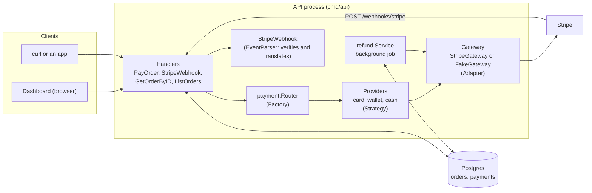
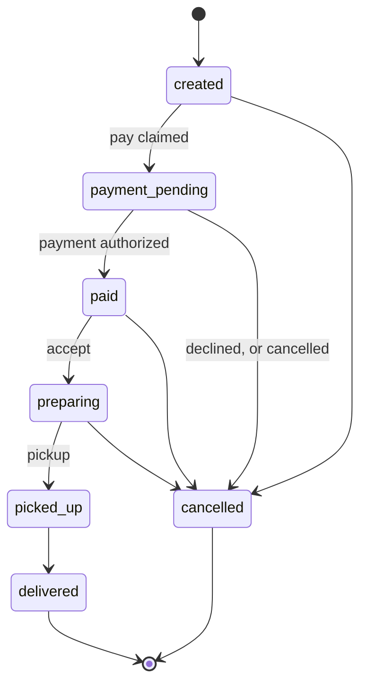
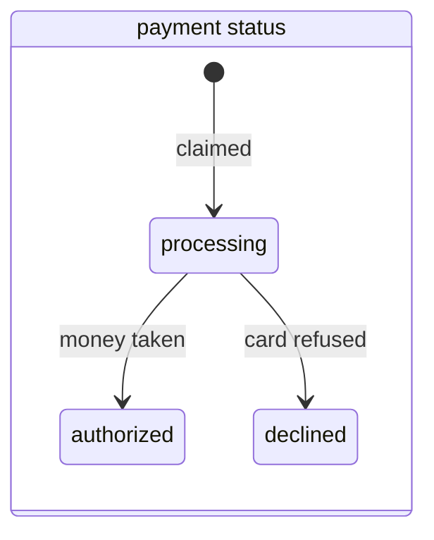
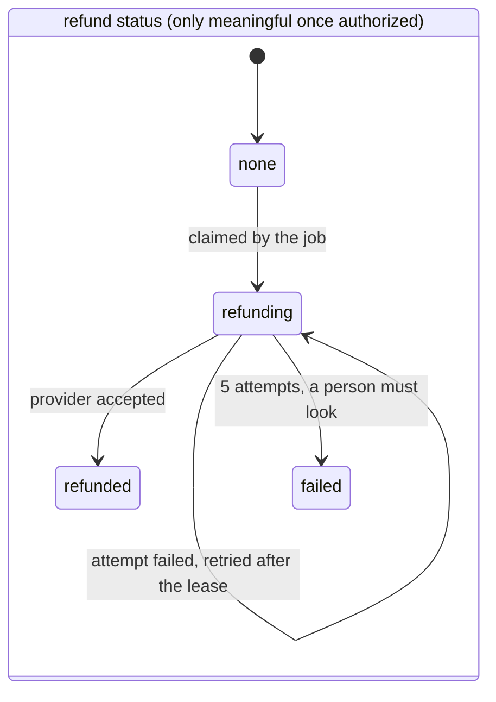
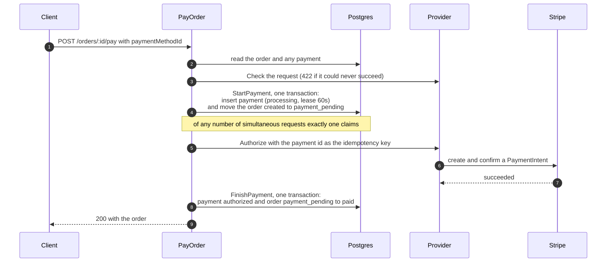
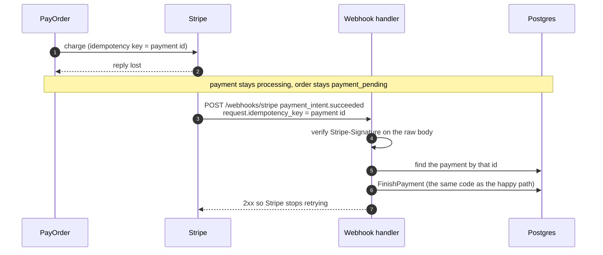
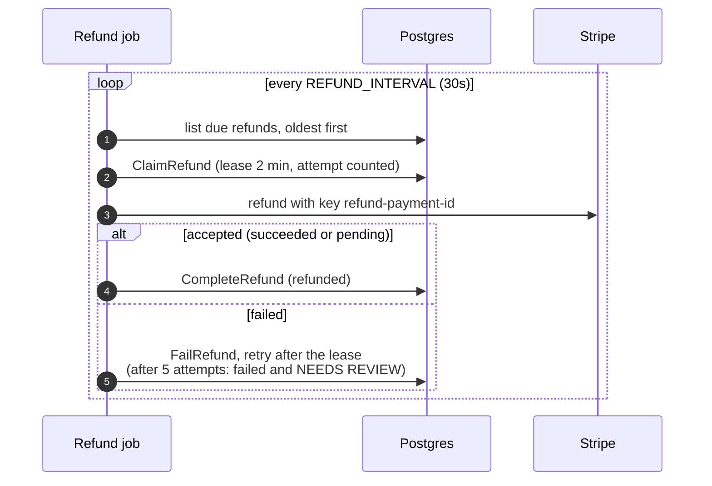

# Payment flow: high-level architecture

How an order gets paid, what happens when something breaks halfway, and how money
goes back. This describes the code on `main`. For what is deliberately not built
yet, see [KNOWN_ISSUES.md](../KNOWN_ISSUES.md).

The diagrams are Mermaid, which GitHub renders.

## 1. The idea in one paragraph

Paying is two things that must agree: **our record** (an order and a payment row in
Postgres) and **the provider's record** (a Stripe charge). A network can fail
between them at any moment, so the design never assumes a call's answer arrives.
Instead: write down the intent **before** calling the provider, give the call an
idempotency key so repeating it is safe, and have **two independent ways** to learn
the outcome (the reply, and a webhook the provider pushes later). Every write that
changes state is a compare-and-set, so whichever reporter arrives first wins and
the other changes nothing.

## 2. The pieces

| Piece | Where | Job |
|---|---|---|
| Handlers | `cmd/handlers` | HTTP in, HTTP out. `PayOrder` runs the flow below; `PaymentWebhook` records an outcome Stripe pushes; `GetOrderByID` and `ListOrders` add the payment summary and `paymentIssue`. |
| Router | `internal/payment/router.go` | **Factory.** Payment type in (`card`, `wallet`, `cash`), provider out. The handler asks per request because the type is only known after loading the order. |
| Providers | `internal/payment/providers` | **Strategy.** One per payment type. Card and wallet delegate to a gateway; cash authorizes with no gateway. A provider may also refuse a request up front (`RequestChecker`). |
| Gateway | `internal/payment`, `.../gateways` | **Adapter** to the outside. `StripeGateway` speaks Stripe's HTTP API; `FakeGateway` runs everything locally with no network. Both also implement `Refunder`. |
| EventParser | `.../gateways/stripe_webhook.go` | Verifies a webhook's signature and turns Stripe's event into our `payment.Event`. The handler never sees Stripe's format. |
| Stores | `internal/databases/ports`, `.../adapters` | **Repository.** `Store` (orders and payments) and `RefundStore` are interfaces; the Postgres adapter implements them. Handlers never see SQL. |
| Refund job | `internal/refund` | Finds refunds that are due and makes them. |

Dependencies point inward: handlers depend on interfaces in `ports` and `payment`,
and only `cmd/api/main.go` knows which concrete adapters are wired in.

## 3. State

### The order

The allowed moves are one table (`legalTransitions` in `internal/order`). Food
readiness and the assigned driver are separate facts, not states.

### The payment and its refund

One row per order in `payments` (a `UNIQUE (order_id)` constraint is what makes the
claim atomic). It has two independent dimensions:

A payment stays `authorized` forever (the money *was* taken); the refund status
says whether it has been given back.

## 4. The happy path

Three rules that make this safe:

1. **Claim before charge.** If we charged first, every simultaneous request would
   charge, and a crash after the charge would leave no record of it.
2. **The payment's own uuid is the idempotency key.** Asking Stripe again with the
   same key returns the first answer instead of charging twice (for about 24
   hours; see [KNOWN_ISSUES.md](../KNOWN_ISSUES.md)).
3. **The payment row and the order move together** in one transaction, so there is
   never a payment for an order that did not move, or the reverse.

## 5. A retry, a crash, and a takeover

The payment row tells a request what it is. The same endpoint handles both a new
payment and a retry.

| What the request finds | What it does |
|---|---|
| no payment | a new payment: claim, charge, record |
| `authorized` | **replay**: `200` with the current order, no charge |
| `declined` | **replay**: `402` with the same reason, no charge |
| `processing`, lease still live | someone is working on it: `409`, try again shortly |
| `processing`, lease expired | its owner probably died: **take it over** (compare-and-set on the expired lease), then ask Stripe again with the **same** payment id |

A **lease** is a claim with a deadline held in the database row, timed by the
database's clock (so servers with drifting clocks agree). It is not a cache: if it
vanished, two requests could work on one payment, which is exactly what it
prevents.

A retry is always the **customer's** decision. No code re-sends a charge on its
own, because that could charge someone who walked away.

## 6. When the reply is lost: the webhook

If Stripe charged the card but the reply never reached us, the payment would stay
`processing`. Stripe also pushes the outcome to us on its own.

* The event is matched to our payment through `event.request.idempotency_key`,
  which Stripe copies from the charge's `Idempotency-Key` header. That header is
  our payment id, so no metadata is sent.
* The reply and the webhook can arrive in either order, or both. Whichever lands
  first records the outcome; the other finds the payment finished and changes
  nothing. A duplicate delivery is harmless for the same reason.
* Status codes speak to Stripe's retry logic: `2xx` for anything a retry cannot
  improve (an event we do not act on, an unknown payment, already recorded), `400`
  for a request that fails verification, `5xx` only when our storage fails, so
  Stripe delivers it again (it retries for up to about three days in live mode).
* If the request never reached Stripe, no event ever comes (nothing happened).
  No money moved, so the payment stays `processing` and retrying is the
  customer's choice.

## 7. Cancelled while paying, and refunds

An order can be cancelled while a payment is in flight. The provider's answer is
a fact about money and the order is a fact about the kitchen, so they no longer
have to change together: the order stays cancelled and **the answer is kept** (an
authorized payment on a cancelled order). The same state arises when a paid order
is cancelled later.

A refund is **due** when all of these hold, which is derived from the data, so
cancelling needs no extra step:

* the payment is `authorized`,
* its order is `cancelled`,
* it was charged online (cash moves no money through us),
* its refund status is `none`, or `refunding` with an expired lease.

* The claim is a compare-and-set with a lease, the same pattern as claiming a
  charge, so any number of servers can run the job and a payment is refunded once.
* A charge that Stripe says was already refunded counts as success: asking twice
  is never a problem.
* A refund that went through is recorded even while the server is shutting down,
  and an attempt cut short by shutdown is not counted against the payment.
* The customer sees the stage through `paymentIssue` (section 9).

## 8. What can break, and what recovers it

| Where it breaks | Money moved? | What we have | What recovers it |
|---|---|---|---|
| Before the claim commits | no | nothing written | the customer retries |
| Claimed, the request never reached Stripe | no | `processing` | the customer's retry takes over after the lease; otherwise it stays pending |
| Stripe charged, the reply was lost | **yes** | `processing` | the **webhook** (or the retry, within about 24 h) |
| Stripe answered, our write failed | **yes** | `processing` | the webhook, or the retry |
| Order cancelled while the charge was in flight | **yes** | answer kept as `authorized` on a cancelled order | the **refund job** |
| Order cancelled after paying | **yes** | `authorized` on a cancelled order | the **refund job** |
| Two requests pay one order at once | one charge | one row | the claim: the loser replays or gets `409` |
| Webhook delivered twice, or out of order | n/a | already recorded | compare-and-set makes it a no-op |
| Refund call fails | yes, still | `refunding` with an error | retried after the lease; a person is asked after 5 attempts |

The cases not covered (no event ever arrives for a lost charge, a retry after
Stripe forgot the key, a customer paying twice through a new order) are written
down in [KNOWN_ISSUES.md](../KNOWN_ISSUES.md) with what would unlock each.

## 9. What a screen is told

`GET /orders/:id` and `GET /orders` return the order, a `payment` summary (no
provider ids or error text) and a `paymentIssue` derived on every read from the
order and its payment, so it cannot go out of date:

| `paymentIssue` | When | Customer message |
|---|---|---|
| `confirming` | payment `processing` on a pending or cancelled order | "We're confirming your payment. If you were charged and the order doesn't go ahead, it is refunded." |
| `refund_pending` | charged, order cancelled, refund not done | "Your order was cancelled. Your money is on its way back and will be credited soon." |
| `refunded` | the provider accepted the refund | "Your refund has been sent." |
| `refund_failed` | the job gave up | "Please contact support and quote the order id." |
| *(absent)* | nothing to say, and always for cash | |

The dashboard shows these as a message in the order drawer and a pop-up when an
order's issue changes while someone is watching. Nothing is sent to a customer yet.

## 10. Guarantees

1. A payment is **claimed before** the provider is called.
2. An order is **charged at most once**: one payment row per order, the payment id
   is the idempotency key, and every retry reuses it.
3. A payment and its order **change in one transaction**, or neither does.
4. Every state write is a **compare-and-set** on the state the caller read, so a
   lost race answers `409` and changes nothing.
5. A provider's answer is **never dropped**: it is recorded even when the order has
   moved on.
6. Nothing re-sends a charge on its own; a retry is the customer's decision.
7. A refund is made **once per payment**, however many workers run the job.
8. Errors never leak: the cause goes to the log, the client gets a generic message.

## 11. Patterns, where they are

| Pattern | Here |
|---|---|
| Strategy | `PaymentProvider` per payment type |
| Factory | `payment.Router.For` |
| Adapter | `StripeGateway`, `StripeWebhook`, `FakeGateway` behind `Gateway`, `Refunder`, `EventParser` |
| Repository | `ports.Store`, `ports.RefundStore` and the Postgres adapter |
| Dependency injection | the handler receives the router; `main` wires the gateways |
| Chain of Responsibility | the middleware chain and the order validators |
| State as data | `legalTransitions` |
| Observer (pub/sub, across a network) | Stripe's webhook into our handler |

Not used yet but planned: Decorator (a cached payment store, retries and a circuit
breaker around the gateway), Command, Builder, Facade (for `PayOrder`).

## 12. Configuration

| Variable | Effect | Default |
|---|---|---|
| `STRIPE_KEY` | use Stripe (a **test-mode** key while developing); unset uses the fake gateway | unset |
| `STRIPE_WEBHOOK_SECRET` | switch on `POST /webhooks/stripe` (the `whsec_` value); unset answers `404` | unset |
| `REFUND_INTERVAL` | how often the refund job looks for due refunds | `30s` |
| `DATABASE_URL` | another database than the local development one | local Postgres |

With no `STRIPE_KEY` the fake gateway declines a card order over 50,000 cents and a
wallet order over 10,000 cents, and refunds everything, so every path above can be
exercised with no network.

## 13. Where to look

| For | File |
|---|---|
| The whole `/pay` flow | `cmd/handlers/handlers.go` (`PayOrder` and the helpers below it) |
| An answer for an order that moved on | `cmd/handlers/outcome.go` |
| The webhook handler and its signature check | `cmd/handlers/webhook.go`, `internal/payment/gateways/stripe_webhook.go` |
| The claim, lease, takeover and the two transactions | `internal/databases/adapters/payments.go` |
| Refunds: storage, provider call, job | `adapters/refunds.go`, `gateways/stripe_refund.go`, `internal/refund/service.go` |
| What a screen is told | `internal/domain/issue.go`, `cmd/handlers/view.go` |
| The schema | `schema.sql` |
| Try it by hand | `curls.txt` |
